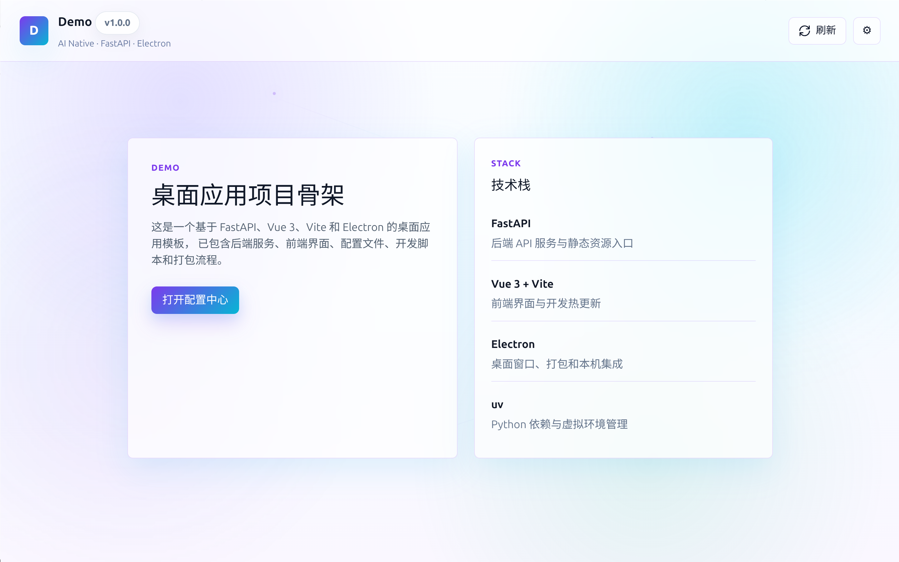

# xb - 前后端打包构建工具

**xb**（PyPI: `xb-init`）是一个基于 `uv` 又类似 `uv` 的项目管理工具，专为快速初始化 **UV + FastAPI + Vue3 + Electron** 桌面应用而生。一条命令拉起完整工程脚手架，开发、构建、版本管理一站式搞定。



## 核心特性

- 一键初始化完整项目结构（`xb init demo`）
- UV + FastAPI + Vue3 + Electron 开箱即用
- 自动安装前端和 Electron 依赖（`npm install`，内置国内镜像源）
- 自动 `git init` 并提交首个 commit（含 lock 文件）
- 自动生成 `AGENTS.md`（AI 编码助手协作约定）
- 内置全局亮色/暗色主题切换
- 可选内置终端（`--terminal`）
- 可选日志中心（`--logs`，后端日志实时推送到界面，排障不用登机器）
- 通用设置页（yaml 加一行"值 + 行尾 `# 显示名`"即自动出表单，注释回填不丢失；secrets.yaml 的 key 自动渲染为密码框）
- 可选应用内自动更新（`--update`，飞书云盘发布 + 版本检查 + 下载校验 + 自动安装）
- 可选 CSV 测试引擎（`--csv-test`，产测专用：CSV 定义测试项、人工确认、PASS 判定、HTML 报告归档与历史查看）
- 可选飞书登录（`--feishu-auth`，OAuth 扫码登录 + 单会话制 + 可开关的强制登录墙，多人协作/服务器部署用）
- 可选飞书群通知（`--feishu-notify`，webhook 只发文字 / 自建应用可发文件附件，产测归档自动推送，业务可直接调用）
- 可选飞书多维表格（`--feishu-bitable`，数据写入多维表格：自动建字段/附件上传/wiki 链接解析，产测勾选推送，业务可直接调用）
- 特权操作免密提权标配（Linux polkit，管理员组无感、无密码落盘；helper 白名单执行器）
- 可选自定义应用图标（`--icon`）
- 老项目增量加特性（`xb add`，三方合并不覆盖业务代码）
- 老项目模板升级（`xb sync`，基建/工具链随 xb 版本演进）
- 内置开发、构建、版本管理命令
- 自动版本检查与一键升级（`xb --upgrade`）
- 环境诊断（`xb doctor`）
- Linux DEB 与 Windows NSIS 安装支持

## 安装

```bash
# 安装 uv（若已有可跳过）
curl -LsSf https://astral.sh/uv/install.sh | sh

# 方式一：从 PyPI 安装（推荐）
uv tool install xb-init

# 方式二：从源码安装
git clone -b release_v0 https://github.com/xuebli/xb.git
cd xb
uv sync
uv tool install .

# 验证
xb --help
```

## 快速开始

```bash
# 创建项目
xb init demo

# 带内置终端
xb init demo --terminal

# 带日志中心
xb init demo --logs

# 启用应用内自动更新（Ubuntu 更新安装走 polkit 免密提权，管理员组无感）
xb init demo --update

# 启用 CSV 测试引擎（产测：测试项 CSV + 人工确认 + HTML 报告）
xb init demo --csv-test

# 带自定义图标
xb init demo --icon ~/icons/app.png

cd demo
# 启动开发环境（自动完成：依赖同步、Git hooks 安装、polkit 特权入口部署）
xb dev

# 查看状态
xb dev status

# 停止
xb dev stop
```

### 交互式配置表单

`xb init` 会在创建前显示一个单屏配置表单，回车即按当前值创建：

```
  xb init demo — 应用配置
  ↑↓ 移动 · 空格 勾选/取消 · 选中后直接输入 · 回车 开始创建
  ────────────────────────────────────────────────────────
❯ [ ] 应用显示名 : Demo
  [ ] 端口（后端/前端） : 8000 / 8001
  [ ] 内置终端  ✘  (Web 终端组件)
  [ ] 应用内更新  ✘  (Ubuntu 更新安装走 polkit 免密提权)
  [ ] 日志中心  ✘  (实时查看后端日志，排障刚需)
  [ ] CSV 测试引擎  ✘  (产测专用：测试项 CSV + HTML 报告)
  [ ] 应用图标 : 使用默认
  [ ] 跳过依赖安装  ✘  (离线环境可跳过)
```

- `--name/--port/--terminal/--update/--logs/--csv-test/--feishu-auth/--feishu-notify/--feishu-bitable/--icon/--skip-install` 传了的参数
  直接预填进表单并勾上，回车即确认，老用法不受影响
- 文本行（显示名/端口/图标）勾选时若仍是默认值则自动清空，直接输入即可
- stdin 非终端时（脚本/CI 管道调用）自动跳过表单，沿用 CLI 参数

Windows PowerShell 也可以直接运行生成项目脚本：

```powershell
Set-Location demo
python .\dev.py start
python .\dev.py status
python .\dev.py stop
```

使用 `--terminal` 时，Windows 终端使用 PowerShell + ConPTY，支持上下箭头
命令历史、复制粘贴、Tab 补全和 Ctrl+C；Ubuntu/Debian 使用 bash + Unix PTY。
后端、Vite 与终端 WebSocket 默认仅允许本机访问并校验页面 Origin；
在补齐身份认证前不要改为 `0.0.0.0` 暴露到局域网。

Electron 二进制镜像通过 `ELECTRON_MIRROR` 环境变量注入。
若安装过程被网络中断，生成项目的
`electron/prepare.js` 会在 `npm start` 或 `npm run build` 前自动检查并补装
缺失的 Electron 二进制。

> **`xb init` 自动行为**：
> - 执行 `npm install`（frontend + electron），生成 `package-lock.json`
>   离线环境可加 `--skip-install` 跳过，稍后手动安装
>   - 生成的项目用 [nrm](https://github.com/Pana/nrm) 管理 npm 源：`xb init`
>     安装依赖前与 `build.py` 构建前都会自动 `nrm test` 测速所有内置源并切换
>     到最快的（未安装 nrm 时自动全局安装）；项目不放 `.npmrc`，npm 源完全由
>     nrm 全局管理
>   - electron 约 200MB 二进制走华为云镜像下载
>   - uv 源同样自动优化：首次依赖同步（dev.py）与后端构建（build.py -b/-a）
>     前并行实测各镜像（要求最终 HTTP 200），自动切换到最快可用源（约
>     1-6 秒，纯标准库实现，无需额外工具）
>   - 若安装失败或超时，会打印提示但不中断项目创建，可稍后手动重试
> - 执行 `git init` 并提交首个 commit（包含所有文件和 lock 文件）
> - 若检测到 PyPI 有新版 xb，会询问是否先升级再创建项目
> - 若系统未安装 git 或未配置 `user.name/user.email`，打印警告但不阻塞

## 命令一览

| 命令 | 说明 |
|------|------|
| `xb init <name> [--name 显示名] [--port 9000] [--terminal] [--update] [--logs] [--csv-test] [--feishu-auth] [--feishu-notify] [--feishu-bitable] [--icon PATH] [--skip-install]` | 初始化项目 |
| `xb add <特性> [--dry-run] [--force] [--skip-install] [--no-ai] [--verify] [--commit]` | 向已有项目增量添加特性（`logs`/`terminal`/`update`/`csv-test`/`feishu-auth`/`feishu-notify`/`feishu-bitable`） |
| `xb sync [--dry-run] [--force] [--skip-install] [--no-ai] [--verify] [--commit]` | 把老项目的模板/基建升级到当前 xb 版本（特性开关不变） |
| `xb dev [start\|stop\|status]` | 启动/停止/查看开发环境 |
| `xb build [all\|frontend\|backend\|electron]` | 构建项目 |
| `xb build -f / -b / -e / -a` | 构建快捷 flag |
| `xb version [patch\|minor\|major]` | 读取或更新版本号 |
| `xb doctor [--fix]` | 检查开发环境；`--fix` 自动安装 nrm/uv、交互式配置 git 身份 |
| `xb --upgrade` / `xb upgrade` | 升级 xb 到 PyPI 最新版本 |

## 老项目增量加特性（`xb add`）

建项目时没勾的特性，事后不用重建项目：

```bash
xb add               # 列出全部特性及当前状态
xb add logs          # 给已有项目加上日志中心
xb add terminal      # 加上内置 Web 终端（自动 uv sync + npm install）
xb add feishu-auth   # 加上飞书登录（configs 自动补 auth 段，不动已有配置）
xb add logs --dry-run   # 只预览变更，不落盘
xb add update --verify  # 添加后自动启动开发环境验证（探后端健康端点+特性路由）
```

**原理**：`xb init` 会写入 `.xb.json` 清单（渲染上下文 + 已启用特性）并随首个
commit 入库。`xb add` 据此重新渲染"加特性前/后"两份纯净模板做文件树差分：

- 新文件直接落地（撞名备份 `.xb-backup`）
- 缝合点文件（`main.py`/`App.vue` 等）与你的当前代码做 `git merge-file`
  三方合并——**你的业务改动全部保留**，只叠加特性增量
- YAML 配置（`global_config.yaml`/`secrets.yaml`）做**顶层键追加**：
  只补特性需要的缺失段（如 `auth:`/`feishu:`），你已填的值和注释原样不动
- 特性移除的文件（如 csv-test 不生成首页组件）仅在你**没碰过**时才删，
  改过的跳过并提示
- 语义冲突保留 **diff3 三段标记**（当前代码/原模板/新模板），并生成
  `xb-add-<特性>-conflicts.md` **AI 裁决任务文件**。检测到本机装有
  AI CLI（opencode / Claude Code / Codex）时会**询问并直接唤起它**
  读取任务文件完成合并（非交互前台运行，过程全程可见；`--no-ai` 关闭）；
  没装则用任意 AI 编码助手打开项目读该文件即可。xb 自身不调任何大模型
  API——不管 key、代码不出本机，裁决由你已装、已信任的 AI 助手完成

- 老项目没有 `.xb.json` 时会按特征文件自动推断补写
- 老项目（旧版 xb 生成）基建可能缺新特性依赖的 helper，`xb add` 会检查
  特性声明的基础设施符号，缺失时写进任务文件让 AI 一并补齐
- **无 AI 不执行**：预测到冲突/基建缺失时会先探测本机 AI CLI
  （opencode / Claude Code / Codex），一个都找不到就拒绝执行、一个文件都
  不改——xb 不做规则猜测，留下没人会解的冲突标记比不做更糟
- 前置要求：git 仓库且工作区干净（干净工作区 = 出错可 `git checkout .` 全回滚）
- 执行后不自动 commit（默认留 `git diff` 审查环节）；带 `--commit` 则
  自动提交——有冲突时会等 AI 裁决完、校验标记清零 + 基建符号补齐
  + 启动验证通过（如跑了 `--verify`）才提交，任一不满足则放弃提交
- `uv.lock`/`package-lock.json` 等可再生文件不参与合并（装依赖时自动更新）
- 幂等：重复添加已启用特性直接提示退出

## 老项目模板升级（`xb sync`）

`xb upgrade` 升级的是 xb 工具本身；`xb sync` 把**已生成项目的模板/基建**
（`dev.py`、`build.py`、`backend/managers/`、electron 主进程、版本管理脚本等）
升级到当前 xb 版本：

```bash
xb sync              # 升级模板基建（特性开关不变）
xb sync --dry-run    # 预览将升级的文件
xb sync --verify     # 升级后自动启动开发环境验证后端
```

**原理**：base 取项目的**首个 commit**（= init 时旧版 xb 渲染的纯净模板），
theirs 是当前 xb 按同一特性开关渲染的纯净模板，两者差分就是"模板自项目
创建以来的全部演进"，再与你当前代码三方合并：

- 模板没动的文件一律不碰（你的改动天然保留）
- 你从未碰过的文件**直接快进升级**（与首个 commit 逐字节一致）
- 你改过的走三方合并，冲突生成 AI 裁决任务文件（与 `xb add` 同一流程，
  检测到本机 AI CLI 可一键唤起；无 AI CLI 则拒绝执行、不做任何改动）
- YAML 配置同样走两级键补齐；`--icon` 定制的图标文件**永不覆盖**
- 项目是 pull 上游模板而来的（文件不在首个 commit 里）无法判定模板增量，
  跳过并提示人工比对
- 完成后清单里的 xb 版本写回当前版本，作为下次 sync 的参照

## 应用图标

```bash
# 显式指定图标
xb init demo --icon ./my-icon.png

# 不指定时自动查找以下约定路径：
# ./app-icon.png, ./icon.png, ./<package>.png,
# ./assets/app-icon.png, ./assets/icon.png, ./resources/icon.png
```

## 应用内自动更新（`--update`）

> 详细原理与 AI 开发者注意事项见模板内
> **[xb/templates/root/docs/自动更新说明.md](xb/templates/root/docs/自动更新说明.md)**
> （生成的项目会自带 `docs/自动更新说明.md` 与配图）；
> Ubuntu polkit 免密提权的授权机制与调试方法见
> **[xb/templates/root/docs/polkit免密提权说明.md](xb/templates/root/docs/polkit免密提权说明.md)**。

`xb init demo --update` 会让生成的项目内置自动更新能力，
以飞书云盘的一个文件夹作为发布"货架"：

**生成内容：**

| 位置 | 职责 |
|------|------|
| `backend/api/update/` | 更新接口（检查 / 信息 / 下载 / 进度 / 安装） |
| `backend/services/updater.py` | 版本比较、信息拉取、下载校验、配置备份迁移、安装 |
| `backend/services/feishu_client.py` | 飞书接口封装（文件夹列举、并发下载） |
| `backend/managers/secret_obfuscator.py` | 敏感值混淆（`obf1:`，防围观级别） |
| `backend/managers/privileged_manager.py` | polkit 特权客户端（pkexec 调 root 白名单执行器） |
| `backend/app_version.py` | 后端版本号（version_manager 提交时自动同步） |
| `frontend/src/components/version/UpdatePanel.vue` | 更新弹窗（版本信息 / 更新说明 / 迁移明细 / 进度条） |
| `frontend/src/components/version/CommitHistoryPanel.vue` | 版本弹窗里的提交历史 |
| `frontend/src/components/GitVersionBadge.vue` | 顶栏版本号徽章 = 更新入口 |
| `frontend/src/composables/useUpdate.js` | 定时检查 / 下载进度轮询 |
| `scripts/feishu_upload.py` | 发版端：安装包与版本信息上传飞书 |
| `configs/config_changes.json` | 配置迁移清单（顶层 key 是版本号） |
| `build.py` | 增加 `--upload-only` 与构建后发布编排 |

**发版流程：** 在 `configs/secrets.yaml` 填 `feishu.app_id` / `app_secret` /
`update_folder_url` → `./build.py -a` → 确认上传。构建时敏感键自动混淆进
`secrets.yaml.example` 随包分发，构建结束 example 恢复为留空模板。

**客户端：** 启动时 / 每小时 / 点版本号徽章时检查更新；发现新版本后下载
（4 线程分块 + SHA256 校验 + `.part` 防半截包）→ 备份配置 → 按
`config_changes.json` 迁移 → Ubuntu 走 polkit 免密安装（授权规则由 DEB
postinst 预部署，管理员组无感、无密码落盘），Windows 等退出后静默安装。

**飞书侧准备：** 开放平台建自建应用 → 开通 `drive:drive` 权限并发布 →
建云盘文件夹，完整链接填入 `update_folder_url`。开发模式（源码运行）不支持
应用内更新，检查接口返回 `packaged: false`。

## 深入文档

生成的项目自带 `docs/` 说明文档，模板源文件在 `xb/templates/root/docs/`：

| 文档 | 内容 |
|------|------|
| [自动更新说明.md](xb/templates/root/docs/自动更新说明.md) | 应用内自动更新：发版流程、配置迁移清单、AI 开发者纪律 |
| [polkit免密提权说明.md](xb/templates/root/docs/polkit免密提权说明.md) | Linux polkit 免密提权：安全模型、三件套部署、新增特权操作、排障 |
| [打包与运行路径说明.md](xb/templates/root/docs/打包与运行路径说明.md) | 构建产物、DEB/NSIS 安装布局、运行时数据目录、三种运行形态判定 |
| [服务器部署说明.md](xb/templates/root/docs/服务器部署说明.md.j2) | 无头后端服务器部署：Ubuntu systemd / Windows 计划任务、日常管理、升级卸载（`.j2` 按项目渲染包名/端口） |
| [密钥混淆说明.md](xb/templates/root/docs/密钥混淆说明.md) | 敏感值落盘混淆：SENSITIVE_TAGS 判断规则、obf1 格式、触发时机、防围观边界 |
| [csv测试引擎说明.md](xb/templates/root/docs/csv测试引擎说明.md) | 产测 CSV 引擎：测试项格式、指令键注册、HTML 报告、纪律（`--csv-test` 项目） |
| [飞书登录说明.md](xb/templates/root/docs/飞书登录说明.md.j2) | 飞书登录前提条件：开放平台建应用/网页应用/重定向白名单/发布、企业定制域名、单会话制、排障（`--feishu-auth` 项目，`.j2` 按项目渲染端口） |
| [飞书通知说明.md](xb/templates/root/docs/飞书通知说明.md.j2) | 群通知双模式（webhook/自建应用+chat_id）、配置步骤、排障（`--feishu-notify` 项目） |
| [飞书多维表格说明.md](xb/templates/root/docs/飞书多维表格说明.md.j2) | 多维表格上传：配置、完整写入链路（三重门/结构准备/附件并行）、字段映射、排障（`--feishu-bitable` 项目） |
| [版本管理说明.md](xb/templates/root/docs/版本管理说明.md) | 版本号 single source of truth、三模态 bump 弹窗、手动 bump、hook 纪律 |

## 生成的项目结构

```
demo/
├── pyproject.toml          # Python 依赖（uv 管理）
├── AGENTS.md               # AI 编码助手协作约定
├── README.md               # 项目说明（含三种启动方式详解）
├── LICENSE                 # MIT 许可证
├── .gitignore
├── backend/                # FastAPI 后端
│   ├── main.py             # FastAPI 入口（lifespan / CORS / SPA 兜底）
│   ├── backend_build.py    # PyInstaller 打包脚本
│   ├── api/                # API 路由层
│   └── managers/           # 基础设施单例
├── frontend/               # Vue 3 前端
│   ├── package.json
│   ├── package-lock.json
│   ├── vite.config.js
│   └── src/
├── electron/               # Electron 主进程
│   ├── package.json
│   ├── package-lock.json
│   ├── main.js
│   └── resources/          # icon.png/icon.ico/icons/ 图标集 + systemd 单元模板 + Linux DEB hooks
├── version/                # 版本管理（pre-commit hook）
├── configs/                # 配置文件
├── datas/                  # 运行时数据（gitignore）
├── docs/                   # 说明文档（打包路径/自动更新/polkit 提权）
├── dev.py                  # 开发脚本（Windows/Linux）
├── build.py                # 打包脚本（Windows/Linux）
└── .venv                   # Python 虚拟环境
```

## xb 工具自身结构

```
xb/
├── cli.py                  # CLI 入口（Click + Rich）
├── __init__.py             # 版本号
├── commands/               # 子命令实现
│   ├── init.py             #   初始化（升级检查、图标、npm install、git init、写 .xb.json 清单）
│   ├── add.py              #   增量加特性（老项目免重建）
│   ├── sync.py             #   模板/基建升级（首个 commit 为基准的三方合并）
│   ├── dev.py              #   开发环境管理
│   ├── build.py            #   构建
│   ├── version.py          #   版本管理
│   ├── doctor.py           #   环境诊断
│   └── upgrade.py          #   升级 xb
├── templates/              # Jinja2 项目模板
│   ├── backend/
│   ├── frontend/
│   ├── electron/
│   ├── configs/
│   ├── scripts/
│   ├── version/
│   └── root/
└── utils/
    ├── template_engine.py  # 模板渲染引擎
    ├── manifest.py         # .xb.json 项目清单（读写/老项目推断）
    ├── feature_adder.py    # xb add 引擎（树差分 + 三方合并 + 裁决任务文件）
    ├── merge3.py           #   git merge-file（diff3 三段标记）封装
    ├── ai_cli.py           #   本机 AI CLI 探测与唤起（opencode/claude/codex）
    ├── validators.py       # 包名校验
    ├── click_helpers.py    # 中文化 Help 输出
    └── version_check.py    # PyPI 版本检查（24h 缓存）
```

## 环境要求

- **Python**: 3.12+
- **Node.js**: 20.19+（推荐 22 LTS；模板前端使用 Vite 8，Node 18 及以下会构建报错）
- **npm**: 10+
- **uv**: 已安装
- **OS**: Windows 10/11 或 Ubuntu/Debian
- **Windows 终端**: 使用 `--terminal` 时自动安装 Windows 专用 `pywinpty`

Windows 可使用 Python、Node.js、npm 和 uv 的官方安装方式或 `winget` 安装。
Ubuntu/Debian 可使用系统包管理器或官方安装方式。

使用 `xb doctor` 可一键检查所有环境依赖。

## 许可证

MIT
